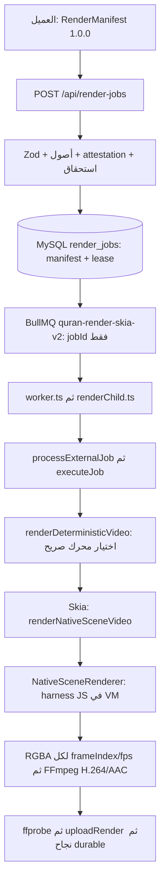

# R0 — جرد خط الريندر قبل D7

قراءة الكود في 2026-10-11، على commit `1b1c99ae88e526ffef64eac34bc0ea9de1ac5c52`. هذا خط الأساس **قبل تنفيذ D7**، وليس تقرير قبول ريندر جديد. قرئت `AGENTS.md` و`package.json` و`VIDEO_PIPELINE_BUGFIX_LOG.md` كاملًا، ثم الملفات المشار إليها أدناه. لم تُكتب قاعدة بيانات، ولم يُشغّل ريندر أو اختبار HTTP موثّق الدخول، ولم تُقرأ أسرار أو تُغيّر Railway. قُرئت مهارة terrain وسياق `.terrain/agent/context.md` ومعجم المشروع؛ السياق لقطة يدوية 2026-10-07، ولا أداة terrain محلية أو repomix/freshness في هذا worktree. لم تُثبّت أدوات لتوليد فهرس؛ كل استنتاج معماري هنا مثبت من المصدر الحقيقي.

## المحرك ومسار المهمة الحقيقي

المحرك المقصود للخدمة الحالية `render-worker-skia` هو **Skia عبر `@napi-rs/canvas` ثم FFmpeg**؛ لا يحتاج Chromium. إعدادات النشر الفعلية يثبتها الجذر بقراءة Railway، فوجود محرك في registry ليس إثبات وجود خدمة منشورة له. `renderEngineRegistry.ts` يحتفظ أيضًا بـ`ffmpeg_ass` و`browser_cloud`، لكن D7 لا ينشئ خدمات لهما. محرك `browser` هو التسجيل المحلي ولا يقبل كمهمة سحابية.

المراجع: [المسار العام](../../server/routes/renderJobs.ts)، [MySQL والطابور](../../server/services/renderJobQueue.ts)، [broker](../../server/services/renderQueueBroker.ts)، [المشرف](../../server/worker.ts)، [child](../../server/renderChild.ts)، [registry](../../server/services/renderEngineRegistry.ts)، [Skia](../../server/services/skiaCanvasRenderer.ts)، [التشفير الأصلي](../../server/services/nativeSceneVideoRenderer.ts)، [المشهد الأصلي](../../server/renderer/nativeSceneRenderer.ts).

`render-control.ts` لا يرسم: ينتخب قائدًا بقفل MySQL advisory، يصلح handoff كل 15s، يستعيد leases كل 30s، وينظف كل 30min، ويشغل ticks للalerts/autoscaler واحتفاظ المحاذاة. العامل يستعيد المهام ثم يبدأ BullMQ ويصالح كل 15s. كل مهمة ترسم في عملية child منفصلة، فتجديد lock لا ينتظر رسم canvas أو FFmpeg. MySQL هو مصدر الحقيقة وRedis يحمل `jobId` فقط؛ lease يبدأ بـUPDATE مشروط `status='queued'`، heartbeat كل10s، completion مشروط `status='running'`. فقد lease يلغي العمل ويرفض نشر ناتج متأخر. [control](../../server/renderControl.ts)، [child runner](../../server/services/renderChildRunner.ts).

## العقد v1 ومصدر النص والتوقيت

`schemaVersion` و`rendererVersion` كلاهما literal **`1.0.0`**. العقد يتضمن: revision، renderEngine/backgroundAsync، aspectRatio/outputDimensions/fps/quality/codec، reciter، canonicalAyahRange بما فيه النص الكامل، contentKind/lyrics، timingMap، audio، audioEffects، background، typography، displaySettings، outputFormat/idempotencyKey. `timingMap` يحمل provenance/review/hash/createdAt/compositionOffsets وكلمات ذات canonicalWordKey/displayWordIndex/occurrenceId/startMs/endMs/letters/phonemes/gaps. `audio` يحمل URL وhash ومدة **بالثواني** وrangeMs وEveryAyah URLs/timestamps. v1 يخلط seconds وms في حقول معروفة، ولا يحوّل D3 تلقائيًا.

[باني العميل](../../src/lib/renderManifest.ts) يرسل النص والتوقيت والصوت من حالة الواجهة؛ الخادم يتحقق ولا يعيد بنائها من جداول D1/D3. `/api/render-jobs` يتحقق من server attestation لخريطة approved وربطها بالمستخدم قبل الاستحقاق/الإنشاء. validator يرفض كلمات بلا نهاية صريحة، خارج interval أو متداخلة، hash مختلفًا للخريطة المعتمدة والصوت، QF أكبر من خمسة أيام، وتحويل speed لخريطة approved وcopyrightProtectionEnabled المتقاعد. علاج blob→EveryAyah التاريخي ما زال موجودًا في v1. [Schema](../../server/models/renderManifest.ts)، [المدخل العام والتحقق](../../server/routes/renderJobs.ts).

إنشاء timingMap الحالي في [PreviewPage](../../src/pages/PreviewPage.tsx):

1. `quranUniversalSlug` → `api.alignments.resolveUniversal`: حزمة QUA/QUD v3.2.0 مثبتة وchapter URL مرتبط بها، approved فقط. الخدمة القديمة تحتوي قائمة SHA/slug ثابتة وكاش حزم صغير؛ ليست قراءة جدول `ayah_timings` الجديد. [الخدمة](../../server/services/quranUniversalAudioService.ts).
2. استراتيجية Quran Foundation/QDC باقية في المصدر وراء `legacyQuranFoundationEnabled()`، وليست افتراضًا مفعلة: server attestation أولًا؛ مسودة متصفح unreviewed إن تعذر. normalization في [timingMap](../../src/lib/timingMap.ts)؛ reciter maps القديمة في مصدر الواجهة.
3. EveryAyah: تنزيل/ضم ملفات الآيات بالمتصفح، boundaries للآية؛ ثم `resolveKnown` لبيانات quran-align المطابقة للفولدر. غياب exact map يبقى verse-only، لا توزيع وقت مصطنع للكلمات.
4. fallback full-surah يزيل map ويعلن تعطيل تحريك الكلمات حتى المراجعة. هذا السلوك التاريخي لا ينتقل إلى v2.

[wordTimingEngine](../../src/lib/wordTimingEngine.ts) يحتوي exact binary-search/waqf ومساعدات phonetic تاريخية؛ مسار exact يرفض map غير approved. harness الحالي نفسه يبحث بـ`start ≤ t < end` فقط عند approved، ويحتفظ بالسابقة في الفجوات، ويقرأ canonical key. لا يصنع event للكلمة عند غياب اعتماد. لكن تحويل absolute/relative موجود محليًا في harness عبر sourceId/rangeMs/compositionOffsets؛ **ليس** `toRenderTimeline`، وwaqf الحالي ليس محدودًا تلقائيًا بفجوة قصيرة. يدعم occurrenceIds بنيويًا، ولا يثبت بمفرده حالات تكرار D3 أو جودة estimated لكل آية.

## جلب الصوت والقص والدمج اليوم

[prepareAudioTrack](../../server/services/deterministicVideoRenderer.ts) ينزل remote **كاملًا** إلى scratch، ثم يحول/يقص بـFFmpeg `-ss/-t` قبل `-i` المحلي إلى PCM WAV 44100Hz/stereo؛ لا HTTP Range ولا عداد bytes في هذه الوظيفة. متعدد EveryAyah يستخدم `Promise.all` ثم concat demuxer، ويمكن قص الملف المركب. بعدها applyAudioEffects؛ Skia يرسل RGBA عبر backpressure إلى FFmpeg، H.264/libx264/yuv420p وAAC و`+faststart` و`-shortest`، وعدد الإطارات `ceil(durationSeconds*fps)`.

هناك كاش محلي تاريخي للأصول في temp `ayahx-render-assets-v1`: حد افتراضي2048MiB، عمر24h وسويب30min، keyed by URL SHA. الصوت غير QF يستعمله ثم copy scratch؛ QF يتجاوزه. cache miss/disabled يفعل direct fetch؛ هذا ليس تغيير مزوّد. لا يُعاد استعمال هذا الكاش لصوت v2: قرار D7 scratch فقط وحذف بعد المهمة. ترك مسار v1 كما هو يوثق التعارض التاريخي ولا يزعم أن سياسته تطابق v2.

[RecitationAudioResolver](../../server/services/recitationAudioResolver.ts) موجود من D4: يتحقق range/coverage/offset v1 أو v2 وhafs، يمنع YouTube بلا ملف مرخص، ويفعل `toRenderTimeline` لتوليد AudioPlan. الربط غير موجود في renderer الحالي. هذه الخدمة ترفض كل needs_review؛ D7 يحتاج فصل أهلية المدى عن سياسة التظليل الآية/الكلمة وفق القرار الأحدث دون استيراد approximate timing. الخدمة المرخصة الحالية تنتج URL موقّعًا لبعض الملفات؛ v2 لا يحفظه في audit/log أو العميل، وR2 يقرأ بصلاحية read-only. بديل same-recording موثق ومثبت، لا تبديل قارئ صامت.

[CatalogAudioSource](../../server/services/catalogAudioSource.ts) أدق من validator القديم: allowlist من DB، HTTPS، رفض signed persistable URLs، DNS public-IP وفحص/تثبيت IP لكل redirect، UA واضح، interval1s وRetry-After. renderer v1 يستخدم validator أصول قديمًا و`fetch`، لذلك تحقق D4 للـHEAD وحده لا يثبت SSRF للـGET في v2. يجب أن ينفذ النقل الجديد قواعد DNS/hops/Range/rate ولا يمرر عنوان العميل لـFFmpeg.

## الخطوط والأصول والتخزين

`NativeSceneRenderer` يقرأ JavaScript داخل [render-harness.html](../../public/render-harness.html) وينفذه في VM مع Canvas/Image adapter؛ لا DOM browser ولا تحميل CSS داخل Skia. يسجل **16 خطًا محليًا** في GlobalFonts من `public/fonts` أو `dist/fonts`؛ CSS harness يحتوي16@font-face محليًا أيضًا، بلا Google Fonts CDN. ملف مفقود يجري تجاهله في المسجل القديم، وcatch تسجيل غير تشخيصي؛ هذا لا يثبت تغطية الجليفات. القرار القانوني لقرآن v2 يقصر على **Amiri / Amiri Quran / Noto Naskh Arabic / Scheherazade New / Lateef / Mada**. لا نغير قائمة الواجهة القديمة هنا. [ملفات الخطوط والرخص](../../public/fonts/README.md).

prepareBackgroundAsset يوطّن الصور/slideshow والفيديو، ويستخرج frames فيديو بـFFmpeg؛ بعض فروعه لها fallback تاريخي. Native Image adapter يستطيع fetch HTTP؛ الشعار والأصل غير الموطّن قد يطلبان شبكة. إذن «محلي fonts» مثبت من الكود، أما **صفر طلب خارجي لكل أصول الريندر** وتغطية كامل corpus Linux فبوابتا اختبار D7 لاحقتان، لا نتيجة هذا الجرد.

scratch `os.tmpdir()/render_skia_<id>` يحذف في finally؛ ملفات الصوت داخله. الناتج قبل النشر في `uploads/renders/<user>/<job>.mp4` (قابل لتغيير RENDER_STORAGE_DIR). عند driver=s3 يرفع [objectStorage](../../server/services/objectStorage.ts) إلى `renders/<user>/<job>.mp4` بـmultipart أجزاء8MiB وتزامن2، ثم يحذف النسخة المحلية؛ driver local يبقيها. التنزيل authenticated same-origin streaming وليس redirect للـsigned URL. نجاح المهمة يحدد انتهاء48h ويكتب saved_videos/notification. GC يزيل الناتج المنتهي وفاشل/ملغى أقدم30min، ويضع رابط المكتبةNULL؛ لا يمحو كل صف تاريخي. احتفاظ QF يمسح نسخة النص/توقيتات manifest وmetadata عند انتهاء الخمسة أيام، مع fence ثم retry marker إذا فشل الحذف. تعليق قديم يقول1h لكن **SQL الفعلي48h**.

## الحدود والذاكرة ونقاط الفشل

BullMQ queues بأسماء `quran-render-{ffmpeg|skia|browser}-v2`؛ اسم queue v2 **ليس إصدار RenderManifest v2**. defaults attempts3/backoff15s exponential، enqueue يضبط attempts2، lock120s، stalledInterval30s، maxStalledCount1. admission governor يقرأ cgroup/overrides، حد أقصى8، CPUtarget85%، headroom90% وreserve؛ ملف Skia الافتراضي512MiB لكلjob/CPU1.5/reserve512MiB، وليس قياس استهلاك فعلي. الفحص5s، يخفض بعدOOM ويستعمل hysteresis. timeoutSkia15min أوoverride. child sampler Linux كل250ms يجمع treeRSS/CPU وأثرOOM؛ قياسWindows unavailable، وcgroup peak ليس وحده peak-job منفردًا. D7 lab يفرض90s وتزامن1 مستقلًا ولا يغير موارد الإنتاج. [capacity](../../server/services/renderCapacity.ts)، [broker](../../server/services/renderQueueBroker.ts)، [autoscaler](../../server/services/renderAutoscaler.ts).

autoscaler لا يعمل إلا flag صريح+token+environment+service IDs للثلاثة؛ default code min2/max5 ليس إثبات نسخ production الحالية. لا ينشئ الجرد خدمة أو يخفضها. worker draining يوقف claims وينتظرchildren، ثم ينهي/يعيدqueue إن انتهى الوقت. no fallback engine: registry dispatch صريح.

`VIDEO_PIPELINE_BUGFIX_LOG.md` سجل تاريخي يغطي: downscale482×858، توقفpreview/rAF، WebM باسمMP4، pauses/phonetic lag، blobURLs، absolute offsets تجمد الآية الأولى، خلفية remote/CORS، seek async/strobe، static-thumbnail overwrite، missingend auto-heal، انفصالeffects/settings. **وصف Chromium + Google CDN + local-only storage + auto-heal missingend الوارد فيه لم يعد وصف الواقع كله**: Skia/local fonts/shared R2/رفض explicit missingend موجودة الآن. أرقامPASS و«<30ms لأي قارئ» في السجل لا تُعاد كقبول D7؛ phonetic pacing لا يثبت دقة كلمة قانونية. probe اليوم يسمح فرقمدة0.2s وفرقfps1، أضعف من±1frame المطلوبة؛ QA الجديد يحتاج gates مستقلة صارمة. [probe](../../server/services/mediaProbeService.ts).

## حد التغيير المعتمد لـD7

يضاف v2 **بجانب** v1: خادم يبني نصD1/timingD3/AudioPlan وhashes، تحويل إحداثياته حصريًا في `shared/timing/toRenderTimeline.ts`، نقل scratch/Range مستقل، سياسة words/ayah per-review، fonts6، QA/golden frames/network/bytes، lab بصلاحيةrender.test، migration007 NULLable. يمكن تمديد dispatch/queue/types بشكل versioned؛ أي فرع v1 يجب أن يبقى بسلوكه وملفاته واختباره القديم. لا تعديل القرآن أوD3، لا D5، لا D8 أوA2b، لا flagعامON، لا توقيتlinks عميلv2، لا تقليل معيار قبول أو تحويل نجاحbuild إلى نجاح صوت/فيديو. يرفق الجذر لاحقًا القياسات الفعلية في `render-verification-report.md`؛ الجرد يمهّد لتنفيذ D7 المفوّض من المستخدم ولا يمنح صلاحية مستقلة.
