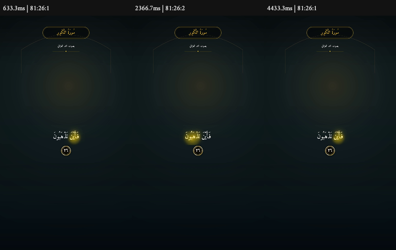
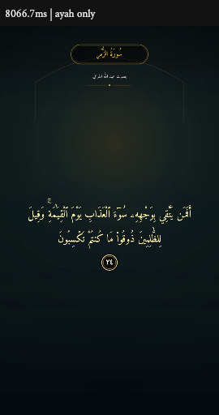

# تقرير الدفعة 4 — D7 ، 12 أكتوبر 2026

**نجح مختبر D7 الخاص فعليًا على production: تسعة فيديوهات ورفضان متوقعان.** بقي العلم العام OFF والواجهة العامة على v1. القيد الأساسي: فهرس Range يعتمد على المرجع الكامل الخاص بـ QA ؛ لا ندّعي تنفيذ قص عام مستقل عنه. النطاق D7 فقط، مع توثيق احتياجات D5. [ملخص النتائج](d7-production-matrix-proof.json).

## ما تغيّر

أضيف RenderManifest v2 بإصدار 2.0.0 بجانب v1. يرسل العميل recitationId/surah/from/to/options/qa:true فقط؛ يبني الخادم النص القانوني والتوقيت و AudioPlan ، ويرفض توقيتًا أو رابطًا من العميل. يحفظ audioPlanHash و timingVersionHash. يشترط الأهلية التقنية وتغطية الكلمات 100%؛ النقص يعيد RANGE_NOT_AVAILABLE مع available_runs ، و YouTube بلا ملف مرخّص يعيد YOUTUBE_RENDER_REQUIRES_LICENSED_FILE. [جرد خط الريندر وحدود التغيير](render-pipeline-audit.md).

التحويل الزمني الوحيد في shared/timing/toRenderTimeline.ts ، بأزمنة صحيحة بالمللي ثانية. يبدأ القص من أول كلمة ناقص pad≤150ms ، دون مقدمة غير موقّتة. يفحص assertTimelineValid البداية والترتيب والفجوات والنهاية مقابل مدة الصوت+200ms. التظليل يتبع أول interval نشط، مع hold≤250ms وربط التكرار بالقانوني؛ needs_review/estimated/فشل الربط تظليل آية فقط. حساب إطارات v2 هو ceil(duration×fps)؛ يبقى سلوك v1 السابق.

أداة POST /api/admin/render-lab/jobs ثم GET للحالة، و CLI مكافئ عبر SSH: صلاحية render.test للدورين admin/super_admin فقط، Origin و rate limit و audit ، مدة≤90s وتزامن عالمي 1. migration007 توسّع render_jobs بثمانية أعمدة nullable: recitation_id VARCHAR(36)، audio_plan_hash و timing_version_hash CHAR(64)، audio_mode_used VARCHAR(32)، fallback_used BOOLEAN ، audio_bytes_fetched BIGINT UNSIGNED ، audio_provider_code VARCHAR(64)، qa_report_json JSON. النصوص الجديدة utf8mb4_unicode_ci ؛ لا FK قديمة أو seed عند startup أو تعديل user_roles. التعريف ثم منح الدورين بعد SUCCESS خطوتان منفصلتان.

## ما تحققت منه فعليًا

### المصفوفة الإنتاجية

كل فيديو مرّ عبر طابور render lab الحقيقي إلى Skia/FFmpeg على Linux ، ثم فُك MP4 لفحص الإطارات والصوت، ثم حُذف ناتجه الجديد. المرجع الصوتي فُك كاملًا مستقلًا. الثلاثة قراء حفص؛ المقاطع الطويلة 70.636/74.315/87.740s تغطي شرط 60–90s. جميع الفيديوهات: NCC≥0.95 ، lag=0ms ، المدة ضمن إطار عند 30fps ، صفر black/tofu/طلبات أصول خارجية، والذاكرة دون حد العامل 1,999,998,976 بايت.

|القارئ / الحالة|سورة:مدى|المتوقع ms|فرق الفيديو ms|NCC / lag ms|أقصى انتقال ms|زمن الريندر s|ذروة RSS للعامل والأبناء MB|النتيجة|
|---|---|---:|---:|---|---:|---:|---:|---|
|عبد الله القرافي / mp3quran-short-complete|103:1–3|16185|15.000|0.999649295 / 0|28.333|33.50|743.55|[PASS](d7-production-mp3quran-short-complete.json)|
|عبد الله القرافي / mp3quran-long-last-ten|26:218–227|70636|30.667|0.999606904 / 0|33.000|82.65|798.78|[PASS](d7-production-mp3quran-long-last-ten.json)|
|أكرم العلاقمي / quranicaudio-short-complete|103:1–3|17015|18.333|0.996976270 / 0|31.667|22.13|754.25|[PASS](d7-production-quranicaudio-short-complete.json)|
|أكرم العلاقمي / quranicaudio-long-last-ten|26:218–227|74315|18.333|0.997955217 / 0|31.667|87.35|825.99|[PASS](d7-production-quranicaudio-long-last-ten.json)|
|محمد الغزالي / archive_org-short-complete|108:1–3|13496|4.000|0.999705916 / 0|30.667|29.96|701.38|[PASS](d7-production-archive_org-short-complete.json)|
|محمد الغزالي / archive_org-long-last-ten|56:87–96|87740|26.667|0.993614343 / 0|31.333|188.48|777.67|[PASS](d7-production-archive_org-long-last-ten.json)|
|محمد الغزالي / real-repetition|81:26–26|8120|13.333|0.999549998 / 0|20.000|32.47|753.32|[PASS](d7-production-real-repetition.json)|
|عبد الله القرافي / real-needs-review-full-coverage|39:24–24|15990|10.000|0.999967782 / 0|0.000|20.38|791.78|[PASS](d7-production-real-needs-review-full-coverage.json)|
|ملف ضوضاء مملوك / owned-r2|fixture 2950ms|2950|16.667|0.998776646 / 0|0.000|5.39|734.77|[PASS](d7-production-owned-r2.json)|
|real-incomplete-range|2:3–5|—|—|—|—|—|—|[RANGE_NOT_AVAILABLE](d7-production-real-incomplete-range.json)|
|youtube-without-licensed-file|1:1–1|—|—|—|—|—|—|[YOUTUBE_RENDER_REQUIRES_LICENSED_FILE](d7-production-youtube-without-licensed-file.json)|

ذروة RSS المأخوذة كل 100ms بلغت 825,987,072 بايت. ذروة cgroup المرصودة 849,743,872 بايت، دون oom/oom_kill ؛ هذه ذروة عمر الخدمة وليست منسوبة لكل مهمة على حدة. مجموع RSS قد يحسب صفحات مشتركة أكثر من مرة، لذلك لا يساوى استعمال cgroup.

التكرار 81:26 عاد إلى الكلمة الأولى مرتين، كما تثبت occurrenceIDs والرسم الفعلي. needs_review39:24 كامل الكلمات؛ نجح بتظليل الآية دون توهج كلمة. اختبار R2 ضوضاء مولّدة ومملوكة تحت test ؛ قرأ العامل بالرمز read-only ونُظف المصدر والناتج. ليس صوت قرآن أو اعتماد حقوق لتسجيل حقيقي. ملفات PNG المحلية والإنتاجية 19 ، بمجموع 1258987 بايت فقط؛ لا صوت أو فيديو في Git.

### بايتات الصوت وحدّ الدليل

|الحالة|مدخل Range للريندر، بايت|المرجع الكامل، بايت|إجمالي QA ، بايت|Range/الفصل|
|---|---:|---:|---:|---:|
|mp3quran-short-complete|270337|296613|566950|91.14%|
|mp3quran-long-last-ten|1370193|25057467|26427660|5.47%|
|quranicaudio-short-complete|328935|378125|707060|86.99%|
|quranicaudio-long-last-ten|1245101|26511862|27756963|4.70%|
|archive_org-short-complete|358561|510403|868964|70.25%|
|archive_org-long-last-ten|1735459|13695722|15431181|12.67%|
|real-repetition|236602|3485804|3722406|6.79%|
|real-needs-review-full-coverage|781585|52321649|53103234|1.49%|
|owned-r2|104699|193768|298467|54.03%|

**قيد معلن:** seek_method=qa_packet_index_remote_range. فهرس حزم MP3 مشتق من المرجع الكامل المطلوب لـ QA ، ثم يُجلب مدخل الريندر بطلب Range بعيد جديد؛ المرجع ليس صوت الريندر. التحذير QA_PACKET_INDEX_FROM_FULL_REFERENCE ظاهر. إجمالي QA أكبر من الفصل؛ لا ندّعي توفير إجمالي تنزيل QA أو تنفيذ قص عام مستقل عن المرجع. مدخل Range للنطاقات الطويلة 4.70–12.67% من حجم الفصل. يلزم قرار seek metadata لمسار غير QA قبل الربط العام في D8 ، دون تنفيذ D8 الآن.

NoRange له تنزيل محدود 128MiB وتحذير ظاهر. تحققت حدود المعدل و 429/Retry-After و User-Agent والمضيفين المسموحين وتثبيت DNS ومنع SSRF. نطاق archive إضافي 2:42–46 رُفض بـ AUDIO_SIZE_LIMIT لأن المصدر 188,093,615 بايت؛ لم يُرفع السقف، وليس جزءًا من الفيديوهات التسعة. تجربة fastseek سابقة أخفقت NCC ولم تُعتمد.

### الفشل المحفوظ والتصحيح

[المهمة الأولى عبر الطابور](d7-production-first-attempt-mp3quran-short-complete.json) فشلت: الصوت مبتور 395.4375ms رغم ارتباط مرتفع. الحارس رفضها؛ لم تُحسب نجاحًا. سبب Linux المثبت: -frames:v ينهي FFmpeg قبل اكتمال AAC. أصبح v2 يرسل عدد raw frames المحدد ثم EOF ويترك الصوت المحدود يكمل، دون -frames:v أو -shortest ؛ v1 كما كان. [إعادة إنتاج Linux](d7-linux-audio-eof-repro.json)، [قبول 60fps](d7-linux-audio-eof-repro-60fps.json). نُظف ناتج المهمة الفاشلة الجديدة، وبقي تقرير QA وسجلها.

لقياس AAC يُزال الذيل المعلن فقط ضمن 1024 عينة AAC مع سماح عينة تحويل واحدة. تُفحص مدة المسار المعلنة ومدة PCM بعد هذا الحد كلتاهما؛ لا تصحيح إزاحة صوتي أو تخفيف للمعايير. اختبارات 30/60fps والبتر والطول الزائد و nonAAC نجحت. فحص الأسود يقرأ YMAX لكل إطار بدقته الكاملة: pure black رصد 3 ، والقرآن على أسود 0. [اختبار mutation](d7-qa-mutation-proof.json) أزال حارس المدة فأفشل اختبارًا ثم أعاده؛ [إعادة فحص MP4 المحلية الثمانية](d7-local-qa-review-recheck.json) نجحت بالقياس الجديد.

رسالة SSH الفعلية أثبتت SSH_CONNECTION_LIMIT ؛ لا دليل على فشل worker أو OOM. نقل gzip عبر stdin مع SHA صار جلسة واحدة، والانتظار الدوري داخل جلسة واحدة. استئناف فحص مهمة ناجحة يشترط بصمتي المصدر والتوقيت ولا ينشئ مهمة ثانية. [تعافٍ دون restart](d7-ssh-recovery-proof.json)، [واقعة رفض SSH قبل إنشاء مهمة](d7-refusal-ssh-limit-proof.json). لم تتغير موارد الخدمة أو حدود الاتصالات.

### النسخة و 007 وسلامة البيانات

نسخة age جديدة بعد إغلاق العلم، واستعادة MySQL9.7.2 مع تطابق COUNT/CHECKSUM للـ 63 جدولًا. SHA للمشفر 93810ab93ae401c4b601591010f62bc35e31c175d33f909b886a31e2c79ee8f2. [dry-run](d7-production-migration-dry-run.json) و[apply007](d7-production-migration-proof.json) استعملا SQL نفسه، SHA74b7809cf6e6163613a92dee5e6cf327995cd2bd4330c213881a0e492c19eebf ؛ جلسات متتابعة، 2–3 اتصالات من 60. [تفعيل الدورين](d7-render-lab-activation-proof.json) بعد SUCCESS. down مختبر محليًا فقط؛ قبل rollback للكود القديم تُسحب grantIDs الجديدة أولًا.

أوقف الحارس اختلاف system_settings14→16 قبل DDL. أثبت التدقيق أن جلسة أدمن خارج اختبارات D7 شغّلت العلم وعدّلت availability_mode. أُغلق العلم وفق تفويض OFF بسجل واحد، وبقي إعداد الإتاحة كما اختاره الأدمن، ثم أُخذت النسخة الجديدة. لا تغيير حسابات أو كلمات مرور.

[التحقق النهائي للقراءة](d7-final-integrity-proof.json) نجح: D1=114/6236/77433 ، D3=422463 ، بصمة القانوني eca6ed31262dff3f8013160766e185c5331ef12efff3bc8989448383d40e4fe4. أعداد وبصمات 12 جدولًا محميًا ثابتة، وبصمة الأعمدة القديمة للمهام 72 ثابتة. الزيادة الوحيدة 10 مهام QA موثقة:9 ناجحة والأولى الفاشلة، وسجل إنشاء واحد لكل مهمة. users/profiles/user_roles لم تُمس.

|الجدول|قبل 007|بعد QA|
|---|---:|---:|
|users|13|13|
|subscriptions|16|16|
|payment_requests|3|3|
|saved_videos|7|7|
|render_jobs|72|82|
|system_settings|16|16|
|user_roles|13|13|
|notifications|49|49|

df قبل 007: total4,685,873,152/used1,775,255,552/free2,900,553,728 بايت؛ بعد QA: used1776304128/free2899505152. نمو 1,048,576 بايت بدقة df ، لا ينسب كله لمهمة بعينها. لا snapshot Pro أو تنظيف تاريخي أو تشغيل staging.

### الخطوط و v1 وبوابات النشر

[فحص Linux على العامل الفعلي](d7-worker-font-proof.json):77,433 كلمة قانونية، 21,202 فريدة×6 خطوط، 68 رمزًا مرئيًا، 43 دفعة؛ صفر missing/empty/طلبات أصول خارجية. الخطوط محلية من public/fonts: Amiri و AmiriQuran و NotoNaskhArabic و ScheherazadeNew و Lateef و Mada. الخروج 137 للمحاولة الأولى سببه غير محسوم، ولا cgroupOOM مثبت؛ لا ننسبه إلى OOM.

[v1 قبل/بعد](d7-railway-v1-comparison.json): baseline من ملفات الكود القديمة الفعلية 1b1c99ae88e526ffef64eac34bc0ea9de1ac5c52 ، و after3dac144 ؛ manifest/PCM/بصمات RGB/72 إطارًا/2.4s متطابقة. NCC0.999101174 و lag0. Skia/FFmpeg فعليان على Railway بصوت مملوك، دون SQL ؛ لا يمثل قبول طلب v1 عبر الطابور.

[PR21](https://github.com/jokertools12/AyahX/pull/21) و[PR22](https://github.com/jokertools12/AyahX/pull/22) مدموجان بعد CI أخضر؛ [SUCCESS للخدمات الأربع على 3dac144](d7-eof-aac-deployment-proof.json). [لوج الخدمات الست](d7-post-deploy-logs-proof.json):1503.4s بعد النشر، صفر error severity وصفر رسائل error/fatal/exception/failed ، دون بلوغ حد 500 سطر. [health/ready200 و lab401/no-store](d7-live-read-smoke-proof.json). smoke متصفح قراءة 4/4 للهاتف وسطح المكتب بعد النشر، وتقاريره الخاصة خارج Git.

[PR23 يسلّم المشغلات والتقرير والأدلة](https://github.com/jokertools12/AyahX/pull/23). بوابات تسليمه تُفحص بعد CI/الدمج؛ دليلها النهائي يرافق رد الإغلاق، لأن تحديث هذا المستند يسبق إنشاء تلك النتيجة.

## نتائج الاختبارات

- npm test:1056 ناجحًا/11 متخطى، 143 ملفًا ناجحًا/5 متخطاة، 68.31s في 01:46UTC. الاختبارات الاختيارية المتخطاة ليست نجاحًا.
- tsc ، و admin TypeScript ، و strict ES2023 لجذور المشغّلات الستة، و build: ناجحة. lint لهذه الجذور صفر رسالة، وحارس المتغير tracked أربعة ملفات صفر new. lint العام القديم خارج النطاق. أمر strict التشخيصي بـ ES2022 دون libES2023 رفض findLast ؛ إعادة الأمر بالهدف المطابق لـ Node22 نجحت دون تعديل الكود.
- [الخصائص على البيانات الحقيقية](d7-timeline-property-proof.json):10,000 نطاق/259,437 فحص كلمة/1,170 فصلًا؛ 12 نوع فساد مرفوض. رُفضت 41 محاولة إضافية لتداخل آيات المصدر دون إصلاح D3.
- [RBAC و HTTP و MySQL9.7.2 و Redis حقيقية](d7-render-lab-rbac-proof.json):7 أدوار/13 تحققًا، مع Origin/rate/schema/audit/تزامن 1 ومهمتين فعليتين. إنشاء production عبر CLI بهوية الأدمن القائمة؛ دون كلمة مرور أو جلسة مصطنعة.
- [007 محليًا](d7-migration-local-proof.json):up/activation/down مرتان ثم إعادة التطبيق؛ الأعمدة القديمة محفوظة، و down الإنتاجي مرفوض قبل SQL.
- [المصفوفة المحلية](d7-local-render-matrix-proof.json):8 فيديوهات ورفضان، و[ownedR2 محليًا](d7-owned-r2-local-proof.json) ناجح. المصفوفة الإنتاجية 9 فيديوهات ورفضان مستقلة أعلاه.
- [الحزمة العامة](d7-public-bundle-comparison.json):218671→218680 بايت gzip ،+9 بايت/+0.0041158%. خط أساس الأداة الأقدم 322504 لا يستخدم لإسناد فرق D7. الأدمن lazy و RTL مثبتان بال smoke.

## ما لم يكتمل

قص عام مستقل عن metadata المرجع الكامل غير منفّذ؛ نجاح مختبر QA الخاص لا يثبته. لا واجهة D8 أو محاذاة D5 أو مراجعات A2b أو اعتماد حقوق/هوية صوت/بسملة. بوابة تسليم PR23 تصدر بعد تحديث الملفات، ويُرفق دليلها برد الإغلاق. لا تُستبدل هذه الحدود بنجاح build أو المصفوفة.

## المخاطر

المرجع الكامل يزيد النقل والزمن؛ مقطع archive87.74s استغرق 188.48s. لا SLA عام مستنتج من العينات. قيود SSRF/حجم المصدر/429 صارمة؛ أخطاء المصادر والتداخل ظاهرة دون fallback صامت. رموز R2 مؤقتة بحسب D4 وتحتاج تجديدًا. الحقوق والبسملة والهوية قرارات بشرية، لا تمنحها الأهلية التقنية.

الاستهلاك لل workspace كله 18.2691514120→18.4102181100$؛ الفرق 0.1410666980$، الحد 30$ والتنبيه 20$، المتبقي 11.5898$، التقدير 21.9348$. [قراءة الفاتورة المنقحة](d7-billing-proof.json). لا تكلفة D7 معزولة أو توفير فعلي مُدّعى، ولا موارد production إضافية؛ staging متوقفة.

## الخطوة التالية

تسليم D7 ثم التوقف بعد بوابات PR23 ، بانتظار مراجعة المستخدم. لا D5/D8/A2b. القرارات الذاتية في DECISIONS: فهرس QA المعلن، رفض التداخل بلا تصحيح، حفظ rule-v1 مع حقول المزود التاريخية، hold250ms و ceilv2 ، fixture ضوضاء مملوك، إغلاق العلم ونسخة جديدة بعد التغيير البشري، فحص الخط بدفعات، 007 بخطوتين، إصلاح EOF وقياس AAC المحدود، وتقليل جلسات SSH بلا restart.

### احتياجات D5 — توثيق فقط

[d5-access-needs.md](d5-access-needs.md):hetchyy/tibyan-base-v1 و hetchyy/tibyan-large-v1 أعادا 401 دون مصادقة؛ هذا وحده لا يثبت gated/private أو صحة الاسم. يلزم تحقق المستخدم بحسابه، ومنح المالك أو قبول الشروط عند ظهورها، ثم read token خادمي محدود. أصول SDK الخاصة hetchyy/qua-aligner-assets تحتاج وصولًا وحقوقًا مستقلين؛ صلاحيات مالك Space لا تورث. CPU benchmark أولًا، دون شراء PRO تلقائي أو Space/GPU جديد أو تنزيل نموذج في D7. الأسعار الوثائقية ليست فاتورة أو إذن إنفاق. معيار D5 المعتمد MAE≤30ms و p95≤75ms مقابل QUD بعد أفضل إزاحة ثابتة لكل فصل، ويُراجع بعد benchmark حقيقي.
